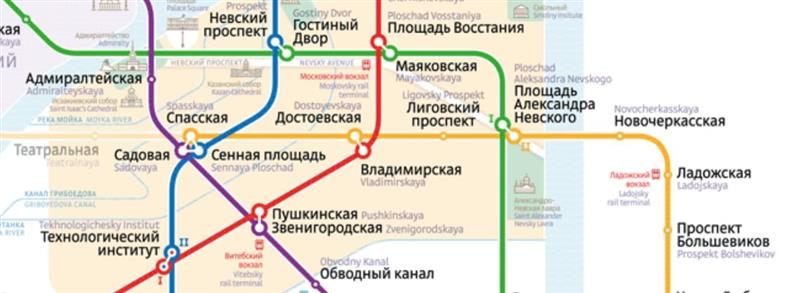

Заполнить граф станциями метро Санкт-Петербурга с картинки из прошлой лабораторной работы. Добавить веса для веток и переходов:

- Зелёная — 4 минуты
- Фиолетовая — 5 минут
- Синяя — 6 минут
- Красная — 3 минуты
- Жёлтая — 2 минуты
- Переход между станциями — 1 минута
